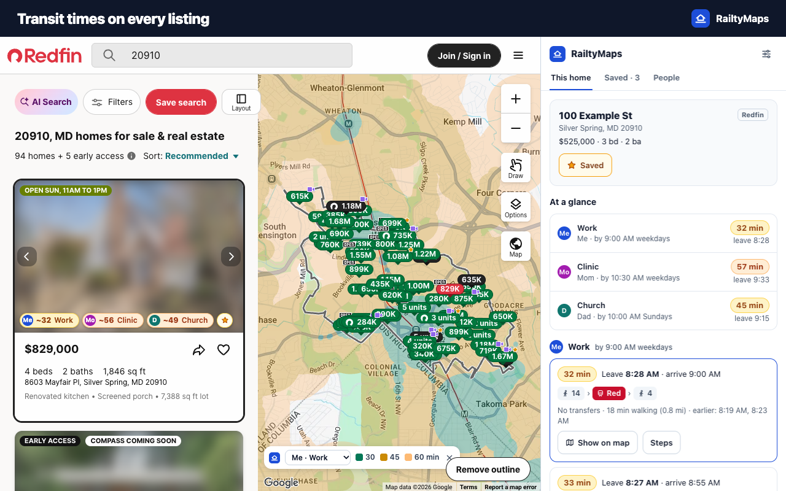

# RailtyMaps

Transit times on Zillow and Redfin listings, for everyone in your household.



If someone you live with gets around by bus and Metro, house hunting turns into copy and paste: find a listing, paste
the address into a trip planner, check each place they need to get to, then do it all again for the next listing.
RailtyMaps does that part. Every listing card gets a time for each person and each place, the map shades the area that
can get there on time, and a side panel has the actual routes.

It covers the Washington, DC area: Metro and Metrobus, MARC, VRE, Ride On, Fairfax Connector, ART, DASH, TheBus and the
smaller county systems. Other regions are a matter of time zones and testing more than code (see
[Limitations](#limitations)).

## What you get

- **A time on every search result.** One pill per place, like "Mom · Clinic · ~41", colored from green to red. Hover
  for the stop and the walk; click for routes.
- **The map, shaded.** Pick a place and the listing map shows where you can live and still get there on time, in
  30, 45 and 60 minute bands. Metro, rail and bus lines are drawn on top, and each place gets a pin.
- **Routes for one home.** When to leave, every walk and ride ("Ride On 14, then the Red Line"), transfers, total
  walking, and when the same trip runs earlier or later. "Show on map" draws it on the listing map.
- **Saved homes, side by side.** Star the ones you like. The Saved tab ranks them by average or worst trip and copies a
  plain-text summary you can paste into a family group chat.
- **People, not just places.** Each person has their own walking pace, longest walk and step-free setting, because a
  10-minute walk for one person is a 20-minute walk for another.

## Install

The Chrome Web Store listing is on its way. Until then, from source:

```bash
git clone https://github.com/devAgam/railtymaps.git
cd railtymaps
npm install
npm run build
```

Then open `chrome://extensions`, turn on **Developer mode**, click **Load unpacked** and pick `.output/chrome-mv3`. Pin
RailtyMaps to the toolbar and click it to set up. Needs Chrome 116 or newer.

## How the numbers work

Every time means **how many minutes before the deadline you have to leave home**. "34" for Work, arriving by 9:00, means
leave by 8:26. That includes walking and waiting, so a bus that comes twice an hour counts against a home even if the
ride itself is short. For getting somewhere on time, that's the number that matters.

Times with a **~** are quick estimates. For each place, RailtyMaps asks the trip planner once for every stop that can
still reach it in time (about 17,000 stops for downtown DC at 90 minutes). A home's estimate is then the best
"walk to a nearby stop + time from that stop", using that person's walking speed and limit. This is how every listing on
a search page gets a number from one request, and checked against full trip plans it has come out within about two
minutes.

Times without a ~ come from a full trip plan, which runs when you open a home in the side panel or ask for exact times on
the Saved tab.

Schedules are the agencies' published timetables for the next ordinary Tuesday or Wednesday (or the next Saturday or
Sunday for weekend places). Live delays aren't included.

## How it fits together

```
zillow.com / redfin.com
  ├─ zillow.content.ts, redfin.content.ts   (isolated world)
  │    find listing cards → ask the background for times → draw badges
  │    lib/content/run-site.ts is shared; lib/sites/*.ts knows each site's markup
  └─ map.content.ts                          (page world)
       finds the site's Google Map and draws transit lines, shading, pins, routes

background.ts → lib/handlers.ts
  reach.ts     one "who can get there in time" query per place, cached a week
  estimate.ts  walk to nearby stops + time from that stop
  plan.ts      full itineraries, on demand, cached a week
  geocode.ts   US Census geocoder for addresses, the router's geocoder for named places
  motis.ts     MOTIS 2 API client and the daily request budget

sidepanel/   React: This home, Saved, People, Settings, first-run setup
```

Both sites build their maps with the Google Maps JavaScript API but don't expose the map object. On Zillow,
`map.content.ts` finds it by walking React's component tree up from the map element. Redfin keeps it on `window`.
If both of those break, it falls back to remembering whichever map the page calls `getBounds()` on, which works after
the first pan or zoom.

Listing data comes from what the sites already put on the page. Zillow has a JSON blob on every search card, and Redfin
has schema.org JSON-LD. Neither depends on CSS class names, which change often.

## Trip planning, and being a good citizen

Routing comes from [Transitous](https://transitous.org), a free trip planner run by volunteers on the open-source
[MOTIS](https://github.com/motis-project/motis) engine, using each agency's own GTFS schedules. Their
[usage policy](https://transitous.org/api/) is the reason for a few design choices:

- One reachability query per place per week covers every listing; full trip plans only run when you ask.
- Results are cached for a week.
- RailtyMaps stops itself at 700 trip searches in 24 hours (their guideline is about 720). Settings shows the count.
- Requests carry a User-Agent naming the app and linking here.

Transitous doesn't allow commercial use. If you want to build something commercial on this code, run your own MOTIS
server (it has the same API, so you just change the routing server in Settings) or swap in a paid provider.

## Privacy

Your people, places and saved homes stay in your browser. The routing server gets coordinates, and the Census geocoder
gets addresses you search for. There's no account, no analytics and no server of ours. Details are in
[PRIVACY.md](PRIVACY.md).

## Development

```bash
npm run dev        # Chrome with the extension loaded and hot reload (WXT)
npm test           # unit tests (Vitest, with a fake extension API)
npm run compile    # type-check
npm run build      # production build into .output/chrome-mv3
npm run zip        # zip for the Chrome Web Store
```

Store screenshots and promo tiles are generated by `npm run store-assets`, which renders the real side panel with a
sample household and injects the real badge and map code into a Redfin search page in headless Chrome. See
[scripts/store-assets](scripts/store-assets).

The code is TypeScript, built with [WXT](https://wxt.dev). The side panel is React; the in-page badges are plain DOM in
shadow roots so the sites' CSS can't touch them.

Adding a site means writing a `SiteAdapter` (`lib/sites/types.ts`): how to find cards, read a listing from one, where
the badge goes, and how to recognize a home's own page. If the site uses Google Maps, the map overlay should work as is.
[CONTRIBUTING.md](CONTRIBUTING.md) has more.

## Limitations

- **DC area only, for now.** Times are computed in Eastern time and the address search is limited to about 100 miles
  around DC. Transitous covers most US metros, so other regions mostly need per-place time zones and some testing.
- **Arrive-by only.** No return trips yet ("leave work at 5 PM").
- **Site changes.** Zillow and Redfin change their pages without notice. When that breaks something, the panel says it
  couldn't read the page instead of failing quietly. Please open an issue.
- **Published schedules.** No live delays, and service changes show up when agencies publish new GTFS feeds.

## Credits

Trip planning by [Transitous](https://transitous.org) and the agencies that publish open data
([sources](https://transitous.org/sources/)). Map data © [OpenStreetMap](https://www.openstreetmap.org/copyright)
contributors. Not affiliated with Zillow, Redfin, WMATA or any transit agency.

## License

[MIT](LICENSE)
